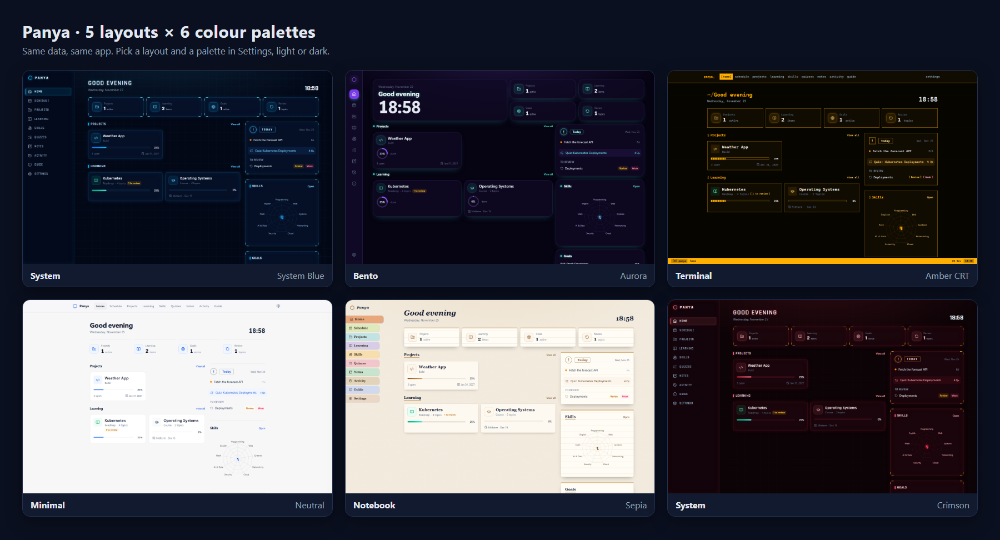
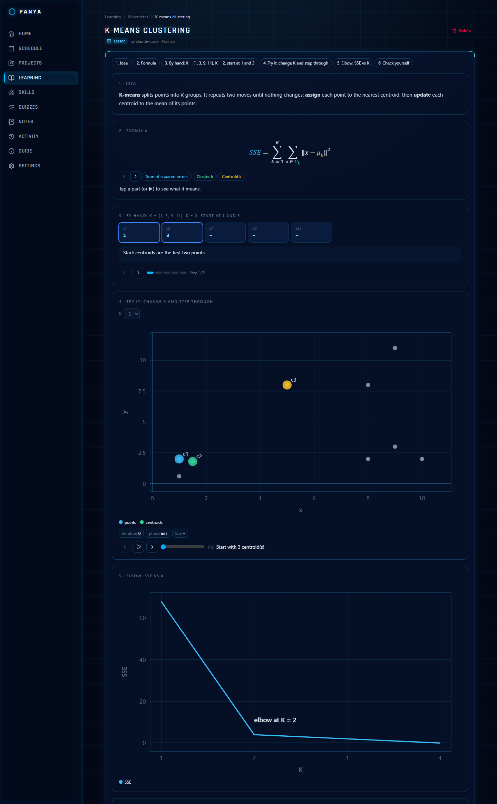

# Tesseract

Tesseract is based on [Panya by jiraphat-j](https://github.com/jiraphat-j/Panya), with the upstream [MIT license](LICENSE) and copyright notice preserved.

AI-native, local-first personal workspace: projects, learning, skills, goals and notes in plain Markdown/YAML, shared by you (web UI) and your AI clients (MCP).

- **Spec:** [SPEC.md](SPEC.md) · **Agent rules:** [AGENTS.md](AGENTS.md) · **Connect AI clients:** [docs/MCP_SETUP.md](docs/MCP_SETUP.md) · **ChatGPT web/phone:** [docs/REMOTE_ACCESS.md](docs/REMOTE_ACCESS.md) · **Phone:** [docs/MOBILE.md](docs/MOBILE.md) · **Google Calendar:** [docs/GOOGLE_CALENDAR.md](docs/GOOGLE_CALENDAR.md)



## What it looks like

| | |
|---|---|
|  |  |
| **Learning:** roadmaps and courses, a map of topics, what to review next | **Projects:** phases, tasks, a system map your AI draws |
|  |  |
| **Quizzes:** your AI writes them, the app grades them honestly | **Lessons:** real math, step-by-step state, simulations you can play with |

Screenshots use the sample data that ships with the repo.

## Run

Requires Node 22.18+ and Git.

```powershell
git clone https://github.com/Tanaboonnnnn/Tesseract.git tesseract
cd tesseract/app
npm install
npm start          # → http://localhost:4320 (this computer only)
npm run lan        # + phone access with one-time pairing, see docs/MOBILE.md
```

On the first run, `data/` is initialized without sample courses, projects, notes or quizzes. The bundled skill taxonomy is available as default configuration; an existing workspace is never overwritten. Upstream screenshots use sample data. `data/` is in `.gitignore`: your notes never go into git.

## Your data and privacy

- Everything lives in `data/` on your computer as Markdown + YAML. Back it up like any folder.
- The server listens on this computer only. Phone access (`npm run lan`) needs one-time device pairing.
- Optional extras use your own accounts and keys, kept outside the repo in `~/.tesseract/`:
  Google Calendar ([docs/GOOGLE_CALENDAR.md](docs/GOOGLE_CALENDAR.md)) and ChatGPT remote access
  ([docs/REMOTE_ACCESS.md](docs/REMOTE_ACCESS.md)). With remote access on, the data ChatGPT reads passes through OpenAI.
- AI clients connect over local MCP: [docs/MCP_SETUP.md](docs/MCP_SETUP.md) (replace the example paths with yours).

## Desktop app (Windows)

Settings, credentials and tokens are separate from upstream Panya in `~/.tesseract/`. Do not copy or commit secrets. If migrating data voluntarily, back up both copies and use only data you have permission to move.


Opens in its own window (Edge app mode, no tabs or address bar) and starts with Windows.

```powershell
cd app
npm run desktop:install    # build + Start menu shortcut + open at sign-in
npm run autostart:off      # keep the shortcut, stop opening at sign-in
npm run desktop:uninstall  # remove both shortcuts
```

Light on resources: the server is a pre-built bundle with small memory limits (~60 MB idle, up to ~95 MB in use; was ~120 MB),
runs at low CPU priority, and exits 15 minutes after the last window closes (0 MB).
The shortcut starts it again in about 2 seconds. Logs: `~/.tesseract/server.log`.
After pulling code changes, run `npm run build:desktop` again.

## Layout

```
app/packages/core   schemas, rules, calculations — the only writer to data/
app/packages/gcal   Google Calendar OAuth + two-way sync (writes only through core)
app/apps/mcp        MCP server for AI clients
app/apps/server     HTTP API (localhost only)
app/apps/web        React web app
data/               your data (Markdown + YAML), not in git
```

## License

[MIT](LICENSE)

## Classroom engineering preview

The application still uses the original workspace pages. No classroom page, publishing endpoint, real course, or tunnel integration is enabled. The new data foundation and isolated MCP profile can be verified against temporary synthetic fixtures before any real course is created.

A separate `--profile classroom` MCP test process can stage drafts without any legacy live-write tools. See [SPEC §11](SPEC.md#11-tesseract-foundation-and-classroom-draft-contract). Keep this test profile local until the classroom UI and live integration are separately approved.

Workspace recovery: [Offline backups and restore preview](docs/BACKUP.md). Paired-device checks: [Device QA checklist](docs/DEVICE_QA.md).
